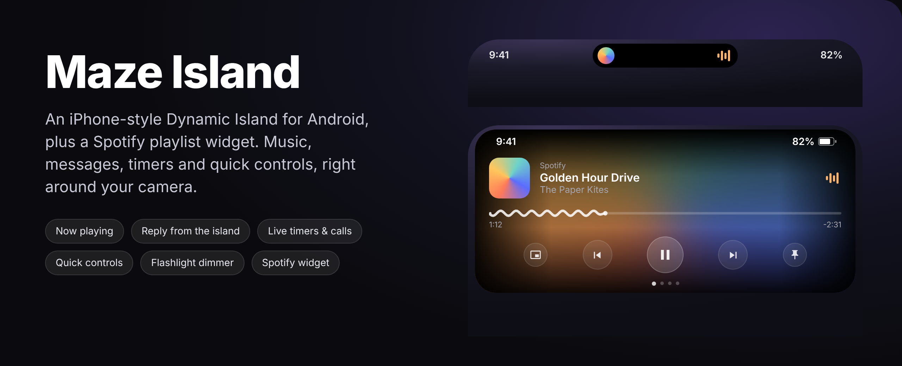
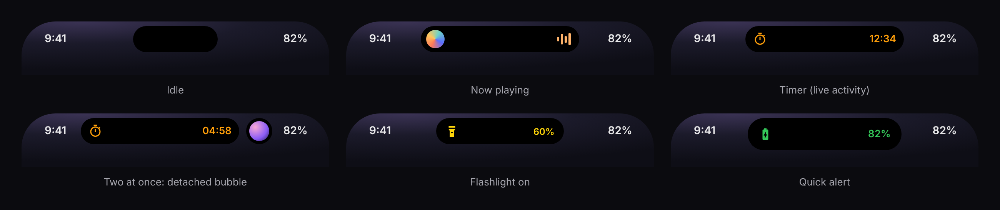
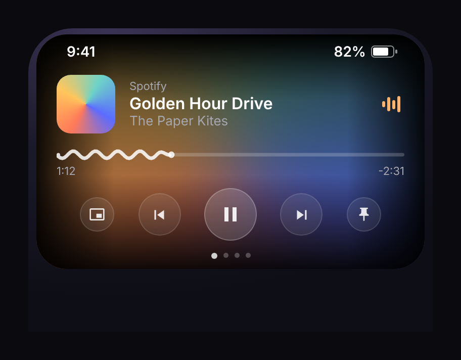
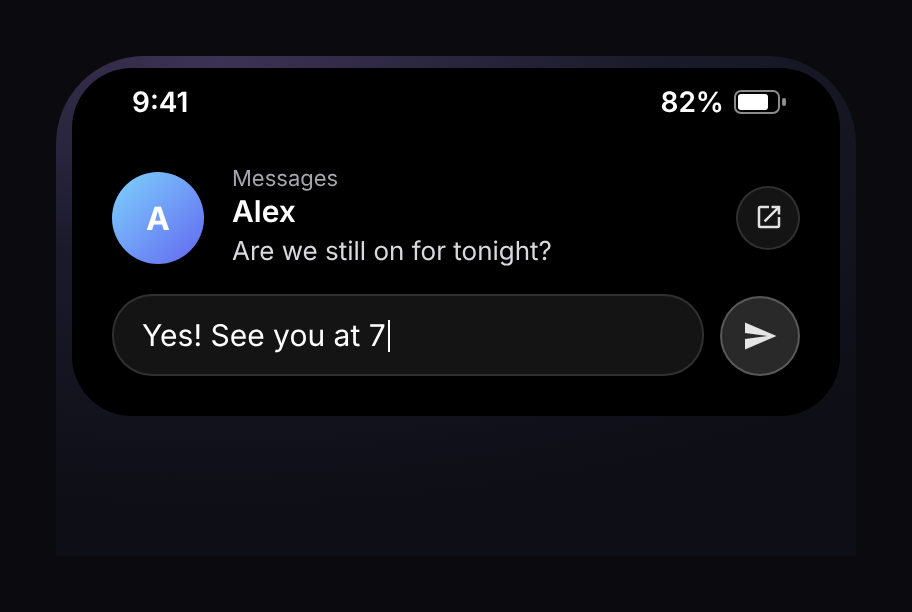
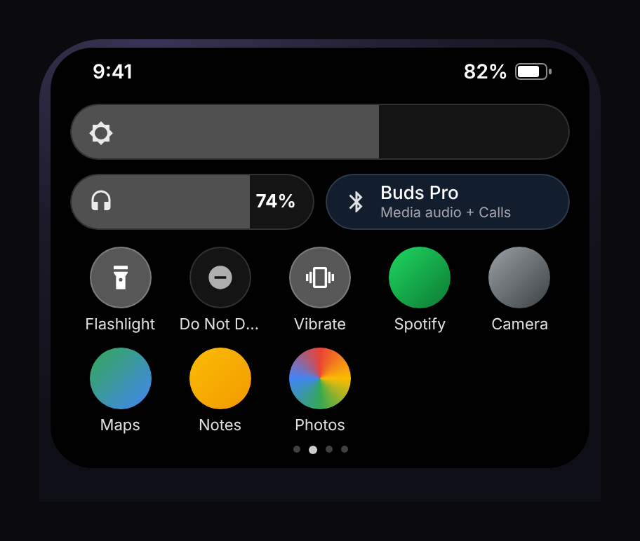
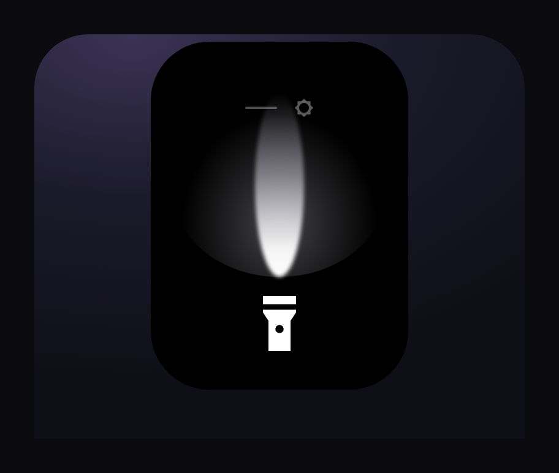
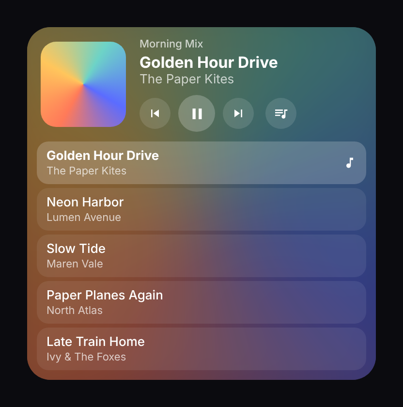

<p align="center">
  
</p>

<p align="center">
  <a href="https://github.com/mazijoni/MazeIsland/releases/latest/download/MazeIsland.apk"><b>Download the latest APK</b></a>
  &nbsp;·&nbsp; Android 8.0+ &nbsp;·&nbsp; Made for Pixel, works on most phones with a hole-punch camera
</p>

---

**Maze Island** turns the camera hole on your Android phone into an iPhone-style Dynamic Island.
It shows what's playing, pops up messages you can reply to right there, keeps timers and calls
running beside the camera, and opens into a little control center with your apps and quick
toggles. It also comes with a Spotify playlist widget for your home screen.

> Mockups are shown above and below; the real thing follows your own album art and settings.

## Features

<p align="center"></p>

### Music
- Album cover and a little equalizer in the island while something plays (Spotify, YouTube Music, podcasts, browsers...)
- Tap to open: blurred cover background, controls, and a **wavy progress bar you can drag to seek**
- Swipe the closed island **left/right to skip** songs
- Several players at once: one tab each (Spotify first)
- No cover? It shows the app's icon, or the **website's logo** for browser media
- **Pin** the card open, or **pop the video out** into Android's picture-in-picture
- Share a YouTube link to **Play in island** plays it inside the island

<p align="center">
  
  
</p>

### Notifications
- Messages pop up in the island; **tap to reply without leaving your app**
- **Swipe sideways** to dismiss, **swipe up** to tuck it away
- Optionally replaces Android's own pop-up banners (see setup)

### Live activities & alerts
- Running **timers, stopwatches, calls and navigation** stay in the island with a live counter
- **Incoming calls** open up with answer / decline
- With two things at once, the second one detaches into a **bubble**, like on iPhone
- Clock app **timers** count down in the island, with Stop / Add a minute when they go off
- **Gemini Live** sessions get their own animated look
- Quick alerts for **charging, low battery, silent/vibrate, Do Not Disturb, Bluetooth headphones connecting**

### App tab & quick controls


- Your favorite apps, with Pixel **themed icons**
- **Brightness** and **volume** sliders
- **Headphone battery** and connected **Bluetooth device**
- Flashlight, Do Not Disturb, sound/vibrate, auto-rotate, Wi-Fi...
- Optional tabs: **weather**, **contacts** (call/text), **front-camera mirror** with selfies

<br clear="right">

### Gestures
| Gesture | Does |
|---|---|
| Tap | Open the island |
| Long press | Open the app that's showing |
| Swipe left / right | Next / previous song, or flashlight brightness while it is on |
| Double tap | Your choice: **flashlight** (with a dimmer, below), screenshot, lock, camera, play/pause, DND... |

<p align="center"></p>

### Spotify playlist widget


- Paste any playlist link, no Spotify login needed
- Blurred cover of the current song as the background
- Play / pause / skip, and a button to open the playlist
- Make it **taller to see and pick songs** from the playlist
- Optional: shows your **Google Home doorbell** snapshot for 2 minutes after a ring (there's a separate doorbell widget too)

<br clear="right">

### Make it yours
Middle or **corner camera** layout, position and size to fit your camera exactly, *always-on* or *hidden until needed* style, colors or **monochrome**,
corner roundness, side padding, icon size/columns/brightness/black-and-white, which tabs and
controls show, and more, all with a live preview.

---

## Install

1. On your phone, open **[the latest APK](https://github.com/mazijoni/MazeIsland/releases/latest/download/MazeIsland.apk)** in Chrome
   (long-press the link → *Open in Chrome* if the GitHub app grabs it) and install it.
2. **"App blocked to protect your device"?** Play Protect blocks sideloaded apps that ask for
   accessibility access. Open the **Play Store, tap your profile, Play Protect, then the settings gear**, turn off
   *Scan apps*, install, then turn it back on. (Or install from a PC with `adb install MazeIsland.apk`.)
3. Open **Maze Island** and turn on **Notification access** and the **Accessibility service**.
   If a switch is grayed out ("restricted setting"): *App info, the menu in the top corner, Allow restricted settings*.
4. *App info, Battery*, set it to **Unrestricted**, so Android doesn't stop the island in the background.
5. Use the sliders to line the pill up with your camera.

Updates install over the old version, just download the link again.

### Optional extras
| Feature | What to do |
|---|---|
| Replace Android's notification pop-ups | Once, from a computer: `adb shell pm grant com.mazedev.island android.permission.WRITE_SECURE_SETTINGS`, then flip the switch in the app |
| Real status bar on top of the island | Allow *Display over other apps* when the app asks |
| Brightness / auto-rotate controls | Allow *Modify system settings* |
| Do Not Disturb control | Allow *Do Not Disturb access* |
| Headphone battery, Bluetooth alerts | Allow *Nearby devices* |
| Weather / Contacts / Camera tabs | Allow location / contacts / camera when you turn them on |

## Privacy

Everything runs on your phone. The only network requests are: playlist name, cover and songs
from Spotify's public pages, website logos (for browser media), and weather from
[Open-Meteo](https://open-meteo.com). No accounts, no analytics.

The accessibility service is only used to draw the island over the status bar and run the
gestures you pick (screenshot, lock, ...). It doesn't read what's on your screen.

## Build it yourself

```bash
git clone https://github.com/mazijoni/MazeIsland
cd MazeIsland
./gradlew assembleDebug        # output: app/build/outputs/apk/debug/app-debug.apk
```

Or open the folder in Android Studio and press ▶. Every push to `main` is built by GitHub
Actions and published as the latest release.

**Tech:** Kotlin, Jetpack Compose (island + settings), Jetpack Glance (widgets), CameraX,
`NotificationListenerService` + `MediaSessionManager` for media and notifications, and an
`AccessibilityService` overlay for the island itself.

<details>
<summary>Project layout</summary>

| Path | What |
|---|---|
| `island/IslandService.kt` | Overlay windows, gestures, shortcuts, lock screen handling |
| `island/IslandUi.kt` | Everything you see in the island |
| `island/ExtraTabs.kt` | Weather, contacts and camera tabs |
| `island/SystemAlerts.kt` | Charging / silent / Bluetooth ... alerts |
| `media/` | Media sessions, notifications, live activities, website logos |
| `widget/` | Spotify playlist widget and doorbell widget |
| `util/` | Quick controls, Bluetooth, weather, contacts, themed icons |
| `ui/` | The settings app |

</details>

## Known limits

- Android doesn't let apps show the real status bar *and* stay tappable above it, so the
  "real status bar" option draws the island just under it (dark icons in light apps can be hard to see).
- Google Play doesn't allow this kind of accessibility use, so the app is only available here.
- YouTube videos play in the island through YouTube's embedded player; some videos don't allow embedding.
- The widget's song list uses Spotify's public embed data, which Spotify could change.

---

<p align="center">Made by <a href="https://github.com/mazijoni">Maze Development</a> · Not affiliated with Apple, Google or Spotify</p>
